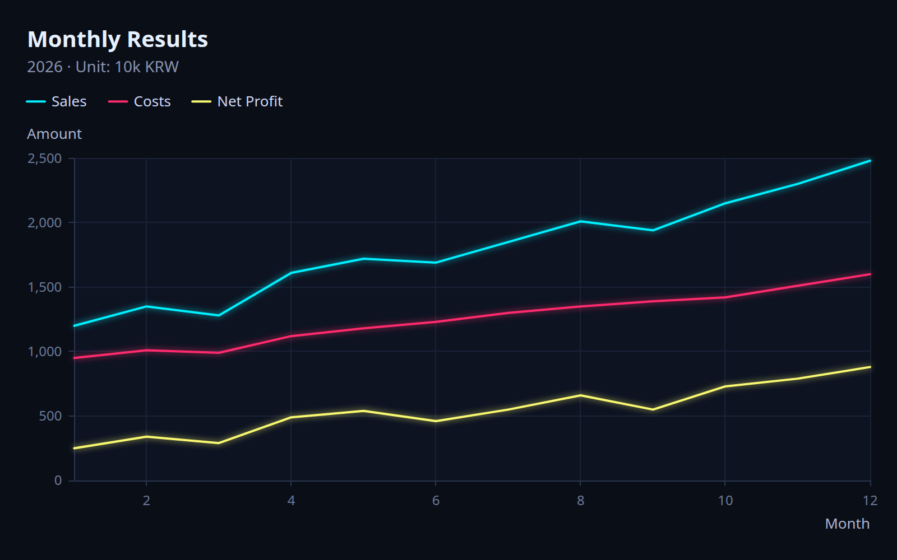
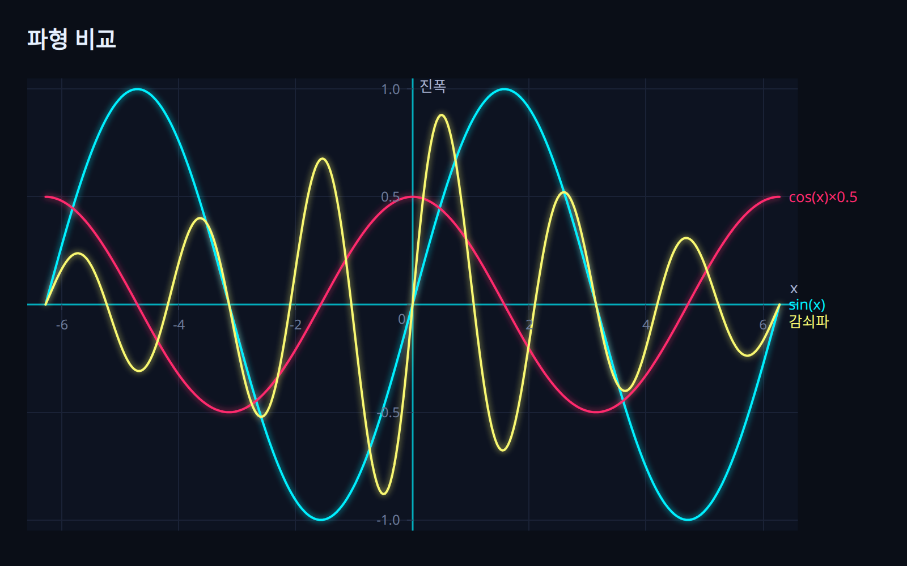
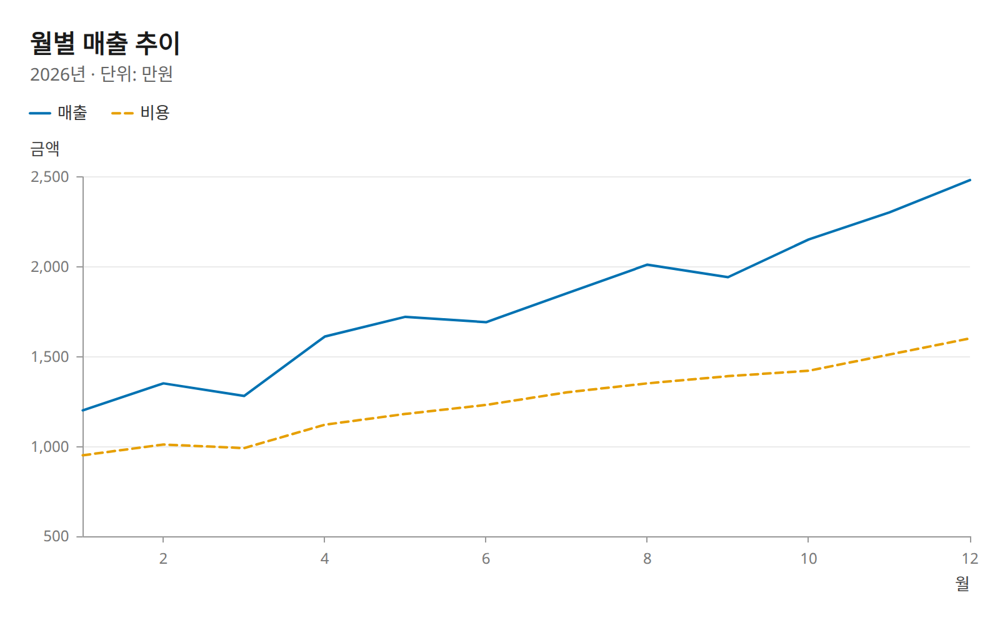
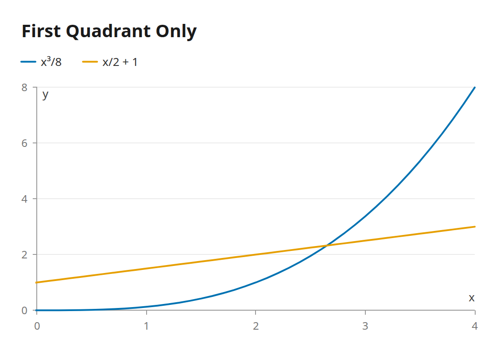
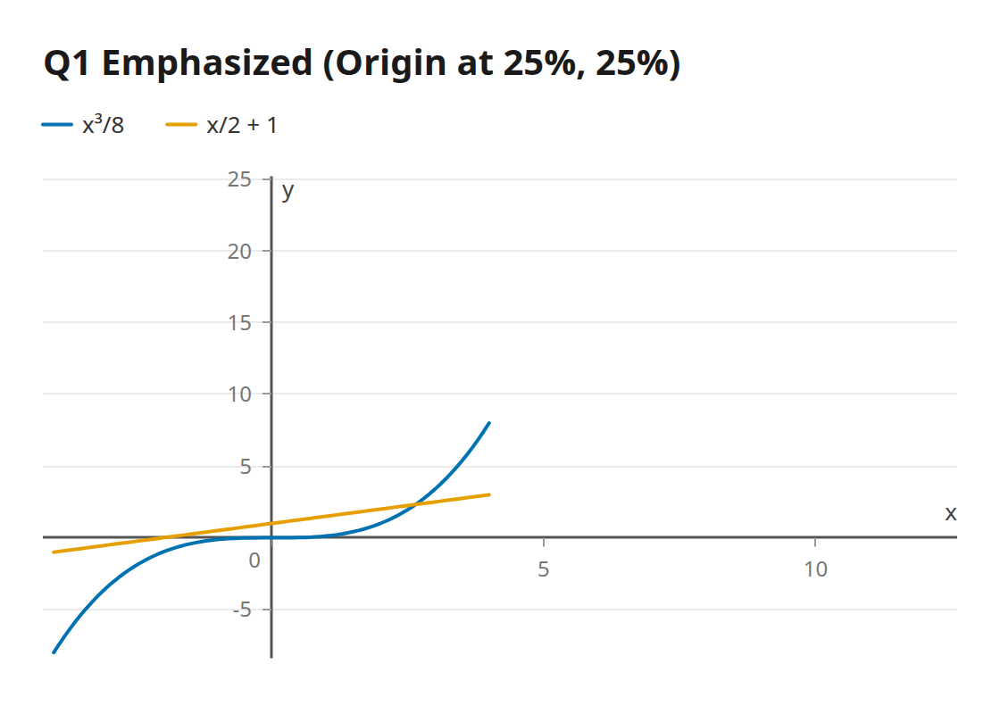
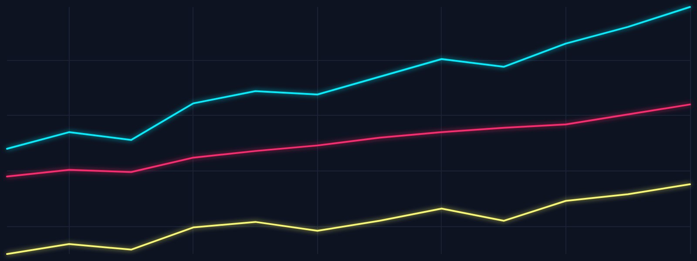

# graph

**Fast, clean SVG charts in Rust, with first-class Korean text support.**



`graph` is a small charting library built for readable charts and for
experimenting. Korean (Hangul) labels just work, millions of points render in
milliseconds, and every visual detail can be customized.

```rust
use graph::prelude::*;

LineChart::new()
    .title("Monthly Sales")
    .x_label("Month")
    .y_label("Amount")
    .series("Sales", &months, &sales)
    .series_with("Costs", &months, &costs, |s| s.dash([6.0, 4.0]))
    .save_svg("sales.svg")?;
```

## Highlights

| | |
|---|---|
| **Korean text** | Korean-first font stack, full-width text measurement, y-axis label never rotated, Korean number units (e.g. `12,000` → 1.2 *man*, `300,000,000` → 3 *eok*), Excel CSV BOM handled. |
| **Quadrants** | Show selected quadrants, put the origin anywhere, or fix ranges. Axes can cross at the origin like in math textbooks. |
| **Space-aware text** | Presets (`Full`, `Compact`, `Minimal`) plus per-element toggles. Hidden text gives its space back to the plot. |
| **Bare mode** | Data only: no text, axes or padding. Add the grid back with one call. |
| **Themes** | `light`, `dark`, `cyberpunk` (with neon glow). Every color and size can be overridden per chart, axis and series. |
| **Performance** | M4 decimation keeps at most four points per pixel column: 2,000,000 points from CSV to a 62 KB SVG in 0.35 s. |
| **Zero dependencies** | The core engine and the SVG backend use only the standard library. |

## Gallery

| Origin axes + direct labels | Light theme |
|---|---|
|  |  |
| **First quadrant only** | **Origin at 25 % / 25 %** |
|  |  |

**Bare mode with grid** (`--bare --grid`)



## Getting started

Requires Rust 1.88 or newer (edition 2024).

```toml
[dependencies]
graph = { git = "https://github.com/TechieQuokka/neon-graph" }
```

### Quadrants and origin

```rust
chart.quadrants(Quadrant::Q1)                    // first quadrant only
chart.quadrants([Quadrant::Q1, Quadrant::Q4])    // right half
chart.origin(0.25, 0.25)                         // origin at 25 % from the bottom-left
chart.x_range(-2.0, 10.0).y_range(-5.0, 15.0)    // explicit ranges
chart.axis_position(AxisPosition::Origin)        // axes through (0, 0)
```

Precedence per axis: explicit range > origin ratio / quadrants > automatic.

### Text visibility

```rust
chart.text_preset(TextPreset::Compact)           // title + tick labels only
     .show(TextElement::Legend, true)            // re-enable one element
     .y_axis(|a| a.show_tick_labels(false))      // hide per axis
chart.bare()                                     // data only
chart.bare().grid(true)                          // data + grid
```

### Styling

```rust
chart.theme(Theme::cyberpunk())
     .background(Color::hex("#05070d"))
     .palette([Color::hex("#00f0ff"), Color::hex("#ff2a6d")])
     .theme_with(|t| t.series.width = 3.0)               // any theme field
     .x_axis(|a| a.line_color(Color::hex("#00f0ff")))    // per axis
     .series_style("Costs", |s| s.dash([4.0, 4.0]).glow(false))  // per series
```

## CLI

A thin command line tool is included for quick testing. Its default skin is
`cyberpunk`.

```sh
cargo run -p graph-cli -- line assets/data/sample_ko.csv --title "Monthly Results"
cargo run -p graph-cli -- line assets/data/wave.csv --origin 0.5,0.5 --legend direct
cargo run -p graph-cli -- line data.csv --quadrant 1 --preset compact --hide legend
cargo run -p graph-cli -- line data.csv --bare --grid --width 1600 --height 400
cargo run -p graph-cli -- line data.csv --theme-file assets/themes/cyberpunk.toml
cargo run -p graph-cli -- theme cyberpunk > my_theme.toml   # dump every theme key
```

CSV format: the first column is x, every other column is a series, and the
header row provides the names. Empty cells become gaps in the line.

Theme files only need the keys you want to change; everything else comes from
the theme named by `extends`:

```toml
extends = "cyberpunk"
background = "#05070d"

[series]
width = 2.5

[glow]
radius = 4.0
```

## Architecture

```text
Data -> Chart (Line, ...) -> Layout -> Scene -> Renderer (SVG, ...)
```

Charts and backends only meet at the backend-agnostic `Scene`, so a new chart
kind or a new output format never touches the other side.

| Crate | Role |
|---|---|
| `graph` | Public facade and `prelude`. Depend on this one. |
| `graph-core` | Engine: scales, ticks, viewport, layout, scene, charts. |
| `graph-svg` | SVG backend. |
| `graph-cli` | `graph` binary: CSV to SVG. |

Examples: `cargo run -p graph --example basic_line` (also `quadrants`,
`custom_theme`).

## License

`graph` is **source-available** under the
[PolyForm Noncommercial License 1.0.0](LICENSE).

- **Free** for personal learning, study, hobby projects, academic research,
  teaching and noncommercial organizations.
- **Commercial use requires a paid license.** See [COMMERCIAL.md](COMMERCIAL.md)
  or contact **everestfesf@gmail.com**.
